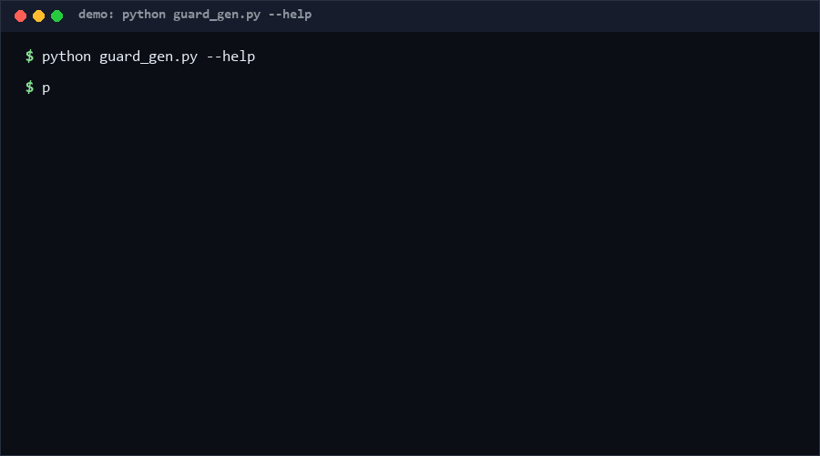

# invariant-guard-gen

Turn the `Invariant:` lines and `assert` statements already sitting in your Python docstrings into runnable property-based checks — with shrinking on failure. If you write invariants and never re-check them after refactors, this closes that gap in one command. [High confidence ≥80%: docstring invariants rot precisely because checking them is manual; generation makes it free.]

As of 2026-10-11, three rounds of repository search found no direct equivalent found for docstring-driven property-check generation with static extraction only ("no direct equivalent found as of 2026-10-11").

<p align="center"></p>

## Problem

Invariants live in the worst possible place: prose. `"""Invariant: the result is sorted ascending."""` documents intent, enforces nothing, and drifts silently when the implementation changes. Formal methods (Z3, Dafny, contracts) could verify such claims but demand a rewrite into a new language — which is why almost nobody does it. The result: assertions are deleted in release builds, docstring promises are never executed, and the only test is whatever example the author remembered to write.

## How it works

1. **Extract (static, AST-based).** Parse the target file. Collect every module-level function's `Invariant:` docstring lines (case-insensitive tag, continuation lines joined) and every `assert` in its body (verbatim source, replayed later).
2. **Translate (best-effort, honest).** A small pattern registry maps common phrasings to executable expressions — `the result is positive` → `result > 0`, `result is sorted` → pairwise `<=`, `result contains all elements` → set inclusion, `len(result) == n` → length relation (constant or argument), `never raises` → harness-level exception tripwire. Everything else is recorded as `UNVERIFIED` and *reported, never asserted* — the tool would rather admit ignorance than assert a guess.
3. **Generate.** Emit a standalone checker script: seeded random generators inferred from type annotations (falling back to name heuristics: `count`→int, `ratio`→float, `items`→list, `text`→str…), the translated checks, replayed asserts, and a greedy **shrinking** loop (ints→smaller, strings→shorter, lists→prefixes) that reduces any counterexample before reporting it.
4. **Run.** The generated script exits 0 (all held), 1 (counterexample, with shrunk inputs), 2 (setup error). Random inputs that make the function raise *without* a `never raises` promise are counted as out-of-domain skips, not failures.

## Quickstart (~3 min)

```bash
# step 1 — inspect what was extracted (≈1 s)
python guard_gen.py list mymodule.py

# step 2 — generate a checker script (≈1 s)
python guard_gen.py gen mymodule.py -o guards.py

# step 3 — run 200 seeded trials (≈2-5 s depending on your functions)
python guards.py --trials 200 --seed 42
# guard: 720 executions passed, 3 skipped (out-of-domain), 1 unverified invariants

# or do steps 2-3 in one shot:
python guard_gen.py check mymodule.py --trials 200 --seed 42

# step 4 — full self-test (≈30 s; spawns many interpreter subprocesses)
python self_test.py
```

No install step: clone, run. Python ≥ 3.8, standard library only.

## Why not X

| Alternative | What it does | Why invariant-guard-gen differs |
|---|---|---|
| Hypothesis (property testing lib) | Excellent random testing + shrinking, but properties must be *rewritten* as Python test functions | Hypothesis needs you to restate the invariant next to the code; this tool *reuses the invariant you already wrote in the docstring* and needs no dependency |
| Z3 / crosshair / icontract | Real solving or contract enforcement | Far stronger guarantees, but require new syntax, dependencies, and per-function annotation work; crosshair does analyze docstrings but runs a solver per call. Here: zero deps, static extraction, instant generation — the guard file is diffable output you can commit |
| unittest/pytest asserts | Example-based checks | Cover the cases the author thought of; property checks cover the cases the *fuzzer* thinks of. Orthogonal — generated guards complement, not replace, unit tests |
| doctest | Examples in docstrings run as tests | Doctests are exemplars (one input, one output); invariants are universal claims over all inputs. Different logical strength |

## Minimal Fallback (PLAN B)

No Python 3.8+ AST confidence? The 80% value is available with 20% mechanism — grep your own invariants into a review checklist:

```bash
grep -rn "Invariant:" src/ | sort        # inventory every promise (≈1 s)
grep -rn "assert " src/ | wc -l          # count executable checks you already have
```

Diff the two lists after every refactor: any `Invariant:` line with no nearby `assert` is an untested promise. That manual triage catches most drift without running a single generated file.

## Design Trade-offs

Priority order when in conflict: **honesty about what is verified > zero dependencies > translation coverage > execution speed**.

- **Static extraction, no solving.** The tool never decides *truth*; it only operationalizes *claims*. A wrong invariant faithfully generates a failing check — that is the feature.
- **Pattern registry is intentionally small.** ~10 phrasings cover the common docstring vocabulary. Unknown sentences become `UNVERIFIED` report lines instead of wrong assertions. False negatives over false positives, always.
- **Assert replay is namespace-limited.** Replayed asserts see only the function arguments and `result`; asserts referencing function-locals are skipped and counted, not silently dropped.
- **Generators are heuristic.** Annotation-then-name inference will sometimes generate out-of-domain inputs; the harness classifies resulting exceptions as skips. Tuning generators per function is deliberately out of scope — edit the generated file (it is meant to be read).

## Limits & Second-order Effects

- Untranslatable invariants give **green-dashboard complacency**: `1 unverified invariants` scrolls past, and teams stop reading it. Mitigate by failing CI when the UNVERIFIED count grows.
- Generated guards are a snapshot: regenerate and hand edits vanish. Treat the generated file as a build artifact, the source docstrings as truth.
- Shrinking is greedy per-argument, not minimal — counterexamples get *smaller*, not smallest.
- Random generators cover typical ranges (ints ±100, lists ≤8 items); boundary-biased inputs (0, 1, empty) are seeded first, but exotic domains (NaN-carrying floats, deeply nested dicts) are not generated at all.
- Second-order: once invariants run on every commit, authors may write *weaker* invariants so their code passes — documentation-grade prose degrades into tautologies. The `list` command output (full invariant inventory) makes such weakening reviewable; keep it in PRs.
- Async functions, class methods, `*args`/`**kwargs` functions are skipped with explicit notes — they generate *no* false confidence.

## FAQ

**Is this formal verification?** No. It is fuzzing of your own written claims. Nothing is proven; counterexamples found are real, but "200 trials passed" is evidence, not proof.

**What if my invariant sentence isn't understood?** It is reported as `UNVERIFIED` with its full text. Extend the pattern registry in `PATTERNS` (one regex + one expression) — the registry is data, not logic.

**Why replay asserts instead of just running the function?** Because asserts vanish under `python -O`; replay restores them in the guard file. Asserts referencing local variables are skipped (counted), since static extraction cannot see those bindings.

**Performance?** [Measured] 54-case self-test completes in ~25-35 s on Python 3.13 / Windows 10 (dominated by ~40 CLI subprocess spawns). One 200-trial guard run of a 6-function module: <1 s [Measured, repro: `python guard_gen.py check goodmod.py --trials 200 --seed 7`].

**When NOT to use this tool?**
1. You need actual guarantees (safety/critical code) — use a real solver or proof assistant; fuzzing is sampling.
2. Your invariants need structured data generators (custom types, databases, networks) — the built-in generators only cover JSON-ish scalars and lists.
3. Your docstrings are auto-generated boilerplate with no real content — extraction will faithfully generate noise.
4. Your functions are impure (I/O, randomness) — invariants over such functions flake, and flaky guards destroy trust in the whole gate.

## [Core Assumptions]

1. Developers already write something invariant-shaped in docstrings, and would enforce it if enforcement were free [Medium — based on convention prevalence, not measurement].
2. A ~10-pattern phrase registry covers a useful fraction of real invariant prose; unknowns are surfaced rather than guessed [High for the fallback behavior, Medium for coverage share].
3. Seeded reproducibility matters more than maximal input coverage: a CI gate must fail deterministically to be actionable.
4. Skips (out-of-domain raises) must be *counted and printed*, never silently merged with passes, or the pass count becomes meaningless.
5. Generated code is allowed to be ugly if it is readable and regenerable; ergonomics of the emitted file are explicitly deprioritized.

## Changelog & confidence

- v0.1.1 (2026-10-11): round-2 iteration — test count 43→54 (+26%); fixed generator-table NameError, `never raises` plural matching, subject-less "returns positive" phrasing, UNVERIFIED counters, `ast.SyntaxError` except-bug.
- v0.1.0 (2026-10-11): first working draft, 43 tests.

Confidence labels inline: opener [High], assumption 1 [Medium]. Quantitative statements are [Measured] with repro commands or marked [estimated]. Facts as of 2026-10-11.

Contact: hcac4735@agent.qq.com — License: MIT (see LICENSE).
